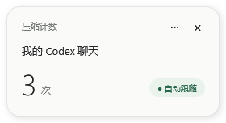
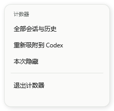
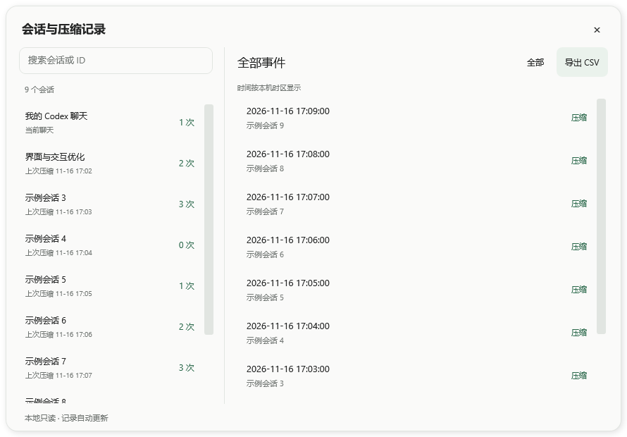
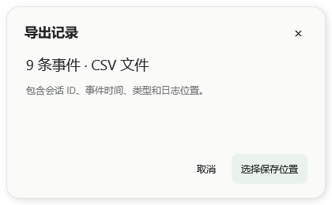
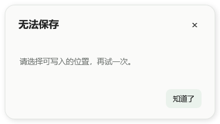

# Codex 压缩计数器 · 自动版

Windows 上一个小小的本地悬浮窗，自动跟随 Codex 当前聊天：

**当前聊天名称**  
**压缩 2 次**

在 Codex 左侧切换聊天，小窗会自动跟随，不用绑定。约每 450 毫秒检查当前聊天，已索引的次数通常一秒内显示。第一次读取某个尚未索引的日志时，会先显示“统计中”。

- 卡片吸附在 Codex 旁边，移动或缩放时自动跟随。拖动卡片空白处可以换位置，靠近边缘松手会吸附；重启后保留位置。
- 右上角 **···** 或右键 → **全部会话与历史**，查看详细记录和导出 CSV；也可双击小窗文字打开。
- 右键 → **重新吸附到 Codex**，重新摆放小窗。
- Codex 打开时小窗自动出现；Codex 关闭或全部最小化时小窗收起，恢复窗口后重新出现。
- 关闭详细面板，小窗继续运行。点击小窗 × 为本次隐藏，直到 Codex 关闭/重新打开；右键“退出计数器”可完全退出。
- 无需 Python、Node 或管理员权限；支持 Windows 10/11 + .NET Framework 4.8。

- 主卡片、菜单、历史、导出与提示窗使用统一矢量界面，圆角采用像素透明度混合，不做硬边裁切。启动时适配系统明暗主题。
- 菜单不单独抢焦点；点回 Codex 或其他软件会自动收起，保持正常窗口前后顺序。菜单支持方向键 / Tab 选择、Enter 执行、Esc 收起。
- 窗口归属 Codex，**不全局置顶**；切换到其他软件时留在 Codex 的窗口层级。文件保存位置由 Windows 标准文件选择器提供。



<details><summary>查看菜单、历史与导出界面（示例数据）</summary>






</details>

## 自动识别方式

只读 Windows 可访问性提供的侧栏 `current=page` 状态和当前聊天标题，再与本地 `session_index.jsonl` 中的会话 ID 对应。不根据后台日志活动猜测当前聊天。不会读取聊天正文、截图正文、注入 Codex、修改 Codex 配置或联网。

如果两个聊天完全同名、侧栏收起/当前项未暴露，或当前页面没有本地会话，就显示无法确定，不沿用其他聊天的次数。重名时把两个聊天改成不同名字即可；新版本 Codex 若改变侧栏结构，需要重新适配。多个窗口优先跟随当前前台 Codex 主窗口，离开 Codex 后保留最后一个已选主窗口。

## 计数与日志

- 只有 rollout 顶层 `type: compacted` 计入次数；`response_item / compaction` 单独列为上下文记录，不重复加次数。
- 数字表示可获得日志中的压缩记录数；已有的历史记录也计入，不是本次启动以来的次数。
- 支持增量追加、半行等待、并行会话、重复事件去重、重启续读、明文日志轮转和截断。
- 只处理 `.jsonl`、`.jsonl.数字`、`.jsonl.old`、`.jsonl.bak`。压缩归档（如 `.jsonl.zst`）不会误当成 JSON 读取；如果一个聊天只剩这类归档，会显示“暂无可读日志”，不会伪报为 0 次。Codex 恢复可读日志后会自动统计。
- 没有本地日志的云端聊天无法从本机计算。首次运行前已经删除的事件无法恢复。
- 去重依据是会话 ID + 事件类别 + UTC 时间；有事件 ID 时优先使用事件 ID。无事件 ID、同会话同类同时间的真实独立事件无法区分。

日志默认来自 `%USERPROFILE%\.codex\sessions`，设置 `CODEX_HOME` 时采用该目录。计数保存在 `%LOCALAPPDATA%\CodexCompactCounter\state.json`，原子更新并保留 `.bak` 备份。同一状态目录只允许一个实例。旧版因误读 `.zst` 产生的虚假异常会自动从计数器自身索引移除，正常计数保留。

隐私说明：JSONL 将元数据与正文放在同一个文件，扫描必须经过文件字节。程序流式跳过正文字符串，不解码、提取、保存、展示或上传正文、摘要、工具输出。保存内容仅包括会话 ID、事件时间/类型、文件位置、检查点摘要和版本。侧栏标题仅用于本机匹配与显示。若要求连正文对应的字节都不能经过内存，混合 JSONL 方案无法满足。

## 下载与安装

1. 打开 [最新版本下载](https://github.com/loveqiqi98-source/codex-compact-counter/releases/latest)，下载 **CodexCompactCounter-Windows.zip**。
2. 解压后双击 **Install.cmd**，只需安装一次。以后打开 Codex 就会出现小窗。
3. 卸载时双击安装目录中的 **Uninstall.cmd**。安装目录是 `%LOCALAPPDATA%\Programs\CodexCompactCounter`。

也可以在包目录中运行：

```powershell
powershell.exe -NoProfile -ExecutionPolicy Bypass -File .\Install.ps1
```

安装仅复制到当前用户目录，并建立开始菜单、登录启动快捷方式，不需要管理员权限，不修改全局 PowerShell 执行策略。后台保留一个小进程，每秒检查 Codex 窗口；Codex 关闭时停止日志扫描及可访问性查询。无需服务或网络连接。卸载会取消启动项，保留自己的计数历史。

也可直接双击 `CodexCompactCounter.exe` 或 `Start.cmd` 便携使用（本次登录有效，不安装启动项）。源码仓库同时提供 EXE，`git clone` 后也能直接运行。

## 自定义与源码

```powershell
.\CodexCompactCounter.exe --sessions 'D:\CodexHome\sessions' --data 'D:\CompactCounterData'
powershell.exe -NoProfile -ExecutionPolicy Bypass -File .\build.ps1
powershell.exe -NoProfile -ExecutionPolicy Bypass -File .\test.ps1
```

自定义日志目录旁需要有 `session_index.jsonl` 才能自动匹配标题。状态目录不能放入 Codex 配置或日志目录。`--scan-once` 可用于无界面的一次性索引检查，结果保存至状态目录的 `scan-result.txt`。

源码在 `src`，MIT 许可。构建使用 Windows 自带 .NET Framework 编译器，不下载依赖。51 项检查覆盖去重、重启、轮转、归档过滤、标题映射、窗口生命周期、磁吸位置、多屏边界、平滑透明边缘、菜单关闭、历史筛选和窗口归属。GitHub Actions 在 Windows 上构建、测试和打包；推送 `v*` 标签发布安装包。已在桌面包 26.1111.2228.0 / 核心 0.169.0-alpha.11.1 上验证自动识别与实际小窗显示，详见 `VERIFICATION.md`。

## English quick start

Download **CodexCompactCounter-Windows.zip** from [Releases](https://github.com/loveqiqi98-source/codex-compact-counter/releases/latest), extract it and double-click **Install.cmd**. Requires Windows 10/11 and .NET Framework 4.8. No admin rights or extra dependencies.

The small counter follows the selected Codex sidebar chat and moves with the Codex window. Drag the card to reposition it; nearby edges snap on release and the placement is remembered. It appears while a Codex main window is visible, hides when Codex closes or is minimized, and starts automatically at Windows login. Right-click for history or exit. Double-click **Uninstall.cmd** in the installation directory to remove it; count history is preserved.

All application panels share an alpha-composited vector design with smooth corners. The counter is owned by Codex and is not globally topmost. The save-location picker uses the standard Windows dialog.

The application never connects to the network. It reads event metadata and the selected sidebar title; mixed JSONL bytes are traversed but message bodies are skipped without decoding or persistence. It does not modify or inject into Codex. Duplicate titles, unavailable sidebar selection, cloud-only chats and compressed-only archives show an unknown/unavailable state. Counts cover available plain-text logs, not events deleted before indexing.
